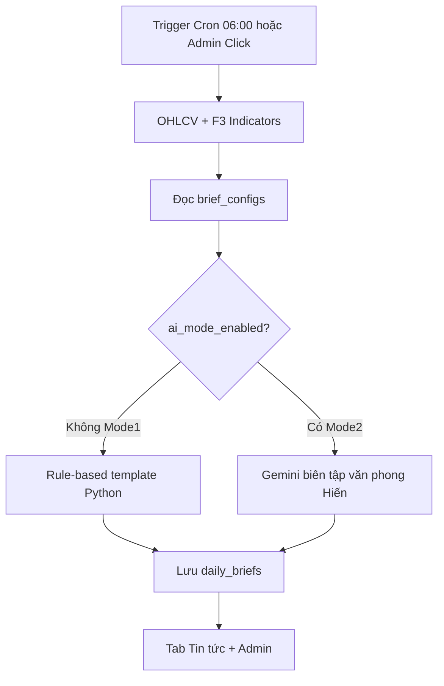

# Hướng dẫn Admin — Bản tin sáng & Watchbook (dev.atz.vn)

Tài liệu vận hành cho admin ATZ Desk trên **dev.atz.vn** (stack `docker-compose.dev.yml`).  
Không áp dụng thao tác này lên prod-desk (`:8001`) trừ khi được yêu cầu rõ.

---

## 1. Tổng quan hệ thống

**Dual Mode (bật/tắt trên Admin)**



- **Mode 1 (mặc định):** rule-based thuần Python — ổn định, không cần API key.
- **Mode 2:** sau khi có draft Mode 1, gọi Gemini để biên tập; lỗi mạng/API → **tự fallback Mode 1** (cron không sập).
- Mỗi sáng **06:00** (Asia/Ho_Chi_Minh, T2–T6) cron host:
  ```bash
  docker compose -f docker-compose.dev.yml exec -T api python -m backend.morning_brief
  ```
- Engine đọc OHLCV, cập nhật watchbook, F3 (BB/Ichimoku D/W/M), ghi `data/signals.db`.
- SPA tab **Tin tức** render Markdown → HTML. Hard-refresh nếu cache cũ.

**Nguồn sự thật**

| Thành phần | Lưu trữ |
|---|---|
| Cấu hình brief (`enabled`, `macro_override`, …) | `brief_configs` trong `signals.db` |
| Danh mục khuyến nghị | `watchlist_portfolio` |
| Bản tin đã sinh | `daily_briefs` (unique theo ngày) |

Crontab mẫu: [`docs/morning_brief_crontab.example`](morning_brief_crontab.example).

---

## 2. Cấu hình Admin Panel

Đăng nhập Desk Session với tài khoản **admin** → tab **Admin**.

### 2.1 Bật / tắt tự động publish

Trong card **Bản tin sáng · Cấu hình**:

1. Tick / bỏ tick **Tự động publish (cron 06:00 / CLI)**.
2. Bấm **Lưu cấu hình brief**.

- `enabled: true` (mặc định): cron và CLI chạy bình thường.
- `enabled: false`: `python -m backend.morning_brief` và nút chạy tay trả lỗi `ERR-BRIEF-010` (không ghi bản tin mới).

API tương đương:

```http
PUT /api/admin/briefs/config
Content-Type: application/json

{ "enabled": true }
```

### 2.2 Ghi chú vĩ mô nhanh (`macro_override`)

Ô **Ghi chú vĩ mô nhanh** ghi đè đoạn nhận định vĩ mô / dòng tiền trong bản tin.

- **Để trống:** engine tự sinh từ VNINDEX (biến động phiên + clause F3 ngày).
- **Có nội dung:** dùng nguyên văn admin (không gọi rule-based index cho khối vĩ mô).

```http
PUT /api/admin/briefs/config
Content-Type: application/json

{
  "enabled": true,
  "macro_override": "Dòng tiền thận trọng sau phiên giảm nhẹ; ưu tiên quan sát nhóm ngân hàng và thép."
}
```

Đọc lại: `GET /api/admin/briefs/config` (response **che** API key — chỉ hiện `••••xxxx` + `gemini_api_key_set`).

### 2.3 Chế độ AI Gemini (Mode 2)

Card **Cấu hình Trợ lý Biên tập AI (Gemini)**:

| Ô | Trường config | Ghi chú |
|---|---|---|
| Kích hoạt Chế độ AI | `ai_mode_enabled` | Mặc định **tắt** |
| Gemini API Key | `gemini_api_key` | Tuỳ chọn; để trống khi lưu = không đổi key cũ. Ưu tiên key SQLite, không thì env `GEMINI_API_KEY` trên container |
| Temperature | `ai_temperature` | 0.1–1.0 (mặc định 0.7) |
| Xoá key đã lưu | gửi `__CLEAR__` | Chỉ xoá key trong SQLite; env server vẫn dùng được |

```http
PUT /api/admin/briefs/config
Content-Type: application/json

{
  "ai_mode_enabled": true,
  "ai_temperature": 0.7,
  "gemini_api_key": "AIza...."
}
```

Gợi ý ops an toàn: đặt `GEMINI_API_KEY` trong env host/compose (**không** commit secret), để trống ô key trên UI.

`body_json.engine` trong brief đã lưu: `rule` | `gemini` | `gemini_fallback_rule` | `rule_missing_key`.

---

## 3. Cấu trúc JSON Watchbook (Portfolio)

Card **Bản tin sáng · Watchbook (JSON)** — mảng các object. Lưu bằng **Lưu watchbook** (`PUT /api/admin/briefs/watchbook`).

### 3.1 Trường dùng trên hệ thống

| Trường | Kiểu | Ý nghĩa |
|---|---|---|
| `symbol` | string | Mã CK (bắt buộc). Lưu upper-case. |
| `buy_price` | number \| null | Giá mua (VNĐ, đơn vị desk). |
| `buy_date` | string \| null | Ngày mua (`YYYY-MM-DD` khuyến nghị). |
| `stop_loss` | number \| null | **Giá cắt lỗ tuyệt đối** (VNĐ). Khi last ≤ mức này → `status = cham_cat_lo`. |
| `resistance` | number \| null | Giá kháng cự. Khi last ≥ mức này → `status = cham_khang_cu`. |
| `status` | string | Trạng thái: `giu` \| `cham_cat_lo` \| `cham_khang_cu` \| `dong` \| `theo_doi`. Engine có thể cập nhật lại theo EOD. |
| `note` | string \| null | Ghi chú nội bộ (không bắt buộc hiện trên tiêu đề). |

### 3.2 Ánh xạ tên hay gọi nhầm

| Trong tài liệu / thói quen | Trường thật trên API |
|---|---|
| `stop_loss_pct` | **Không dùng %** — dùng `stop_loss` (giá tuyệt đối). |
| `action_status` | Dùng `status`. |
| `POST /api/admin/generate-brief` | Alias của `POST /api/admin/briefs/run` (cả hai đều hợp lệ). |

### 3.3 Ví dụ JSON hợp lệ (copy/paste)

```json
[
  {
    "symbol": "FPT",
    "buy_price": 95000,
    "buy_date": "2026-10-01",
    "stop_loss": 88000,
    "resistance": 105000,
    "status": "giu",
    "note": "Core IT — theo dõi BB tuần"
  },
  {
    "symbol": "HPG",
    "buy_price": 28000,
    "buy_date": "2026-09-15",
    "stop_loss": 25500,
    "resistance": 31000,
    "status": "giu",
    "note": "Thép"
  },
  {
    "symbol": "MBB",
    "buy_price": 24000,
    "buy_date": "2026-08-20",
    "stop_loss": 22000,
    "resistance": 27000,
    "status": "theo_doi",
    "note": null
  }
]
```

Lưu ý cú pháp: mảng `[...]`, dấu phẩy giữa object, **không** để trailing comma cuối cùng, chuỗi trong dấu `"`.

Seed bootstrap (chỉ khi DB trống): [`config/morning_brief_watchbook.yaml`](../config/morning_brief_watchbook.yaml).

---

## 4. Kiểm duyệt & chạy thủ công

Dùng trước 06:00 để xem bản nháp trên tab **Tin tức**.

### 4.1 Trên UI

1. (Tuỳ chọn) Sửa `macro_override` / watchbook → **Lưu**.
2. Bấm **Chạy bản tin ngay**.
3. Mở tab **Tin tức** (hoặc **Tải lại**) — kiểm tra heading, bảng HTML, phụ lục F3.
4. Nếu sai: sửa watchbook / macro → chạy lại (ghi đè brief cùng ngày).

### 4.2 API

```http
POST /api/admin/briefs/run
```

Alias:

```http
POST /api/admin/generate-brief
```

Cả hai yêu cầu session admin (cookie Desk / Authentik). Response: `{ "ok": true, "brief": { ... } }`.

Đọc bản tin đã lưu (mọi user đã login theo policy hiện tại của SPA):

```http
GET /api/briefs/latest
GET /api/briefs?date=2026-11-08
```

### 4.3 CLI (trên VPS / trong container)

```bash
cd /opt/atz-desk
docker compose -f docker-compose.dev.yml exec -T api python -m backend.morning_brief
```

### 4.4 Mã lỗi thường gặp

| Mã | Ý nghĩa | Việc làm |
|---|---|---|
| `ERR-BRIEF-010` | `enabled=false` | Bật lại trên Admin |
| `ERR-BRIEF-011` | Thiếu OHLCV index | Kiểm tra `data/ohlcv/VNINDEX.csv` |
| `ERR-BRIEF-020` | Chưa có brief | Chạy tay hoặc chờ cron |
| `ERR-BRIEF-002/003` | Symbol / status không hợp lệ | Sửa JSON watchbook |
| `ERR-BRIEF-030…033` | Lỗi gọi Gemini | Log API; brief vẫn lưu Mode 1 (fallback) |
| `ERR-BRIEF-034` | Bật AI nhưng thiếu key | Cấu hình env hoặc SQLite key |

---

## 5. Checklist vận hành sáng

1. OHLCV đã cập nhật (ít nhất VNINDEX + mã trong watchbook).
2. `enabled=true` nếu muốn cron tự chạy.
3. (Tuỳ chọn) Điền `macro_override` trước đêm.
4. Watchbook JSON hợp lệ, đã **Lưu**.
5. Trước 06:00: **Chạy bản tin ngay** → duyệt tab Tin tức.
6. Sau 06:00: xác nhận log cron `/var/log/atz-morning-brief.log` (nếu đã cài crontab).

---

## 6. Liên kết kỹ thuật

- Engine: `backend/morning_brief.py`
- Store: `backend/morning_brief_store.py`
- Routes: `backend/routers/briefs.py`
- UI: `frontend/index.html` (Admin + Tin tức)
- Journal: [`docs/TECH_JOURNAL.md`](TECH_JOURNAL.md)
