# Làm rõ kiến trúc refresh 1–2s (atz.vn)

**Ngày:** 2026-10-20 (cập nhật: **WebSocket-first**)  
**Trạng thái:** Human chốt — **SSI Market WebSocket = đường chính**; REST = **backup** khi WS lỗi/im lặng.  
**Liên quan:** `docs/architecture.md`, Open Q §5.14 (`PROGRESS.md`), SSI v3 bench / portal docs.

---

## 0. Trả lời ngắn 4 câu hỏi

### 1) “Tách MVC — đúng không? Sao nghe như không phải?”

**Đúng — hệ thống vẫn tách lớp** (gần MVC / layered), không bỏ.

| Lớp (ý MVC) | Trong atz | Việc |
|-------------|-----------|------|
| **Model / Data** | Ingestion + index-feed + Redis (+ SQLite bền) | Lấy giá từ KBS/VCI/SSI → ghi Redis |
| **View** | Streamlit UI (`ui_realtime`) | Chỉ **đọc Redis**, vẽ bảng |
| **Controller / orchestration** | Compose services + config YAML | Ai poll bao lâu, failover, alert… |

Điều dễ hiểu nhầm: khi nói *“UI không gọi API giá mỗi lần refresh”* **không** có nghĩa bỏ MVC.  
Ngược lại: đó **chính là** tách View khỏi nguồn data — View không đi thẳng ra CTCK.

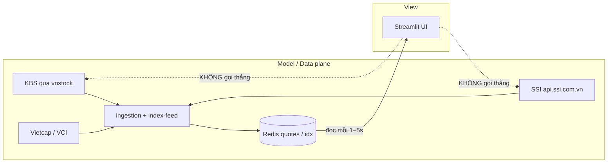

### 2) Parallel polling có làm số liệu / CP tính sai không?

**Phụ thuộc chỗ song song.**

| Việc parallel | An toàn? | Vì sao |
|---------------|----------|--------|
| Nhiều **HTTP GET độc lập** (mỗi mã một request SSI) rồi ghi Redis | **Ổn cho quote từng mã** | Mỗi mã một snapshot gần “now”; lệch vài chục–vài trăm ms là bình thường với near-realtime |
| Tính **chỉ báo / filter trên từng mã** sau khi mã đó đã có quote đủ bar | **Ổn** | Không phụ thuộc mã khác |
| Tính **chỉ số chéo** (tỷ trọng rổ, tương quan, rank cả board) giữa chừng khi mới ghi được 300/1500 mã | **Có thể lệch tạm** | UI thấy “thế hệ” dữ liệu lẫn cũ–mới |
| Song song **nhiều chu kỳ ghi đè** không generation | Rủi ro nhẹ | Reader có thể đọc mix |

**KBS `price_board` batch** (atz đang dùng cho equity): **một response** nhiều mã → cùng một “ảnh” thời điểm → tốt hơn SSI 1-call/mã cho tính chéo.

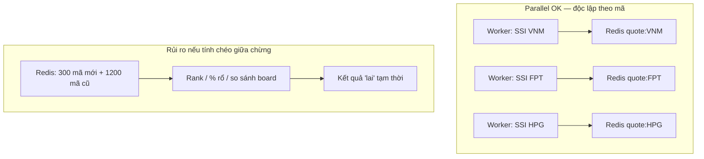

**Cách giữ đúng khi parallel (nếu sau này dùng SSI equity):**

1. Ghi xong cả batch rồi mới “công bố” (pipeline Redis / `board:gen` tăng số).  
2. UI/filter chỉ đọc gen đã complete.  
3. Hoặc chấp nhận near-realtime: lệch &lt; 1s giữa các mã là đủ cho theo dõi, không phải khớp lệnh HFT.

**Hiện tại atz equity:** parallel SSI **không** phải đường chính — KBS batch 1 shot full board → **không** dính vấn đề “nửa board”.

### 3) “Nghĩa là sao?” — điểm WebSocket / epic sau

**REST poll (đang làm):** cứ N giây hỏi lại “giá bao nhiêu?” → tốn request, trễ tối thiểu ≈ interval.

**WebSocket (SSI có trong docs portal):** mở **một kết nối dài**, sàn/CTCK **đẩy** tick khi có thay đổi → Redis cập nhật liên tục → UI chỉ đọc Redis.

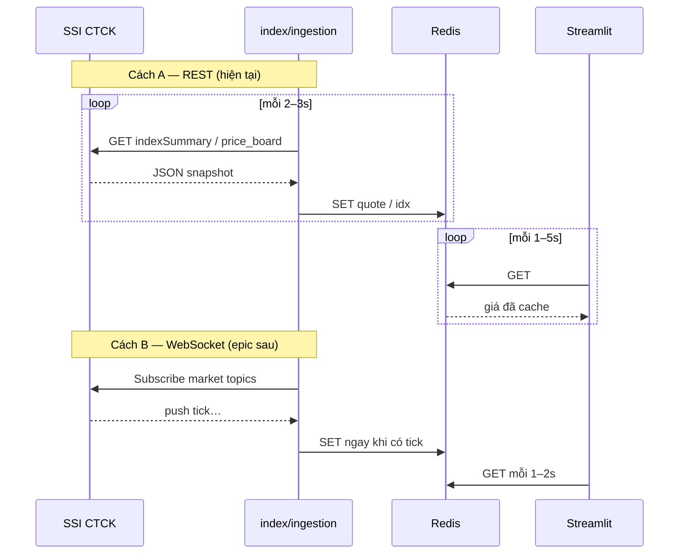

Tóm lại câu 3: *“SSI WebSocket = sau”* nghĩa là **chưa làm**; khi làm sẽ mượt hơn REST nhưng là project riêng (kết nối, reconnect, subscribe), không cần để đạt UI 1–2s trước.

### 4) “Không làm” — giải thích thêm

Những việc **tránh** nếu muốn site nhanh mà không chậm / không cháy API:

| Không làm | Vì sao hại |
|-----------|------------|
| Mỗi user / mỗi fragment UI gọi thẳng KBS/SSI | 30 user × 2s = bão request; chậm + rate-limit |
| Quét 1500 mã bằng SSI `securitiesSummary` tuần tự/parallel để “refresh trang” | Bench ~**84s/1500** @18 rps → không bao giờ 1–2s |
| Coi UI refresh = phải đợi ingestion xong mới vẽ | Trộn View và Model; một nguồn chậm → cả trang đứng |
| Hạ poll xuống 1s + song song vô hạn không limiter | Dễ 429 / circuit open / số liệu giật |

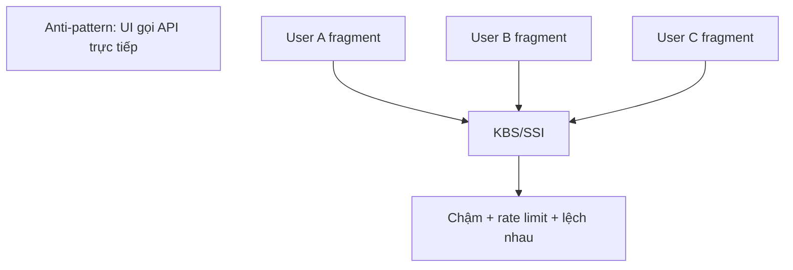

---

## 1. Kiến trúc đúng hướng (giữ tách lớp)

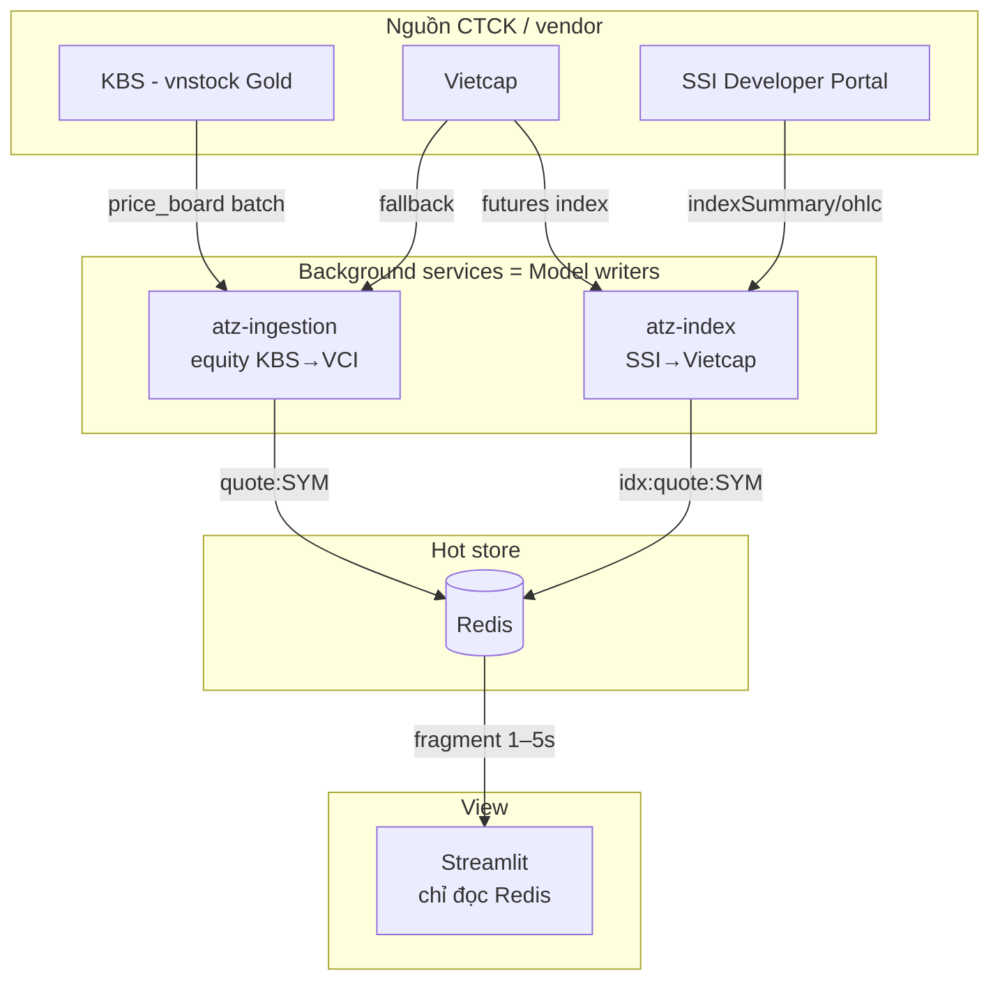

**Ý chính:** “Refresh site 1–2s” = **UI đọc Redis 1–2s**.  
Tốc độ “đúng giá” phụ thuộc ingestion/index **đã ghi Redis gần đây thế nào**, không phải mỗi lần vẽ bảng lại đi hỏi CTCK.

---

## 2. Ba lựa chọn triển khai (chưa chọn)

### 5a — Chỉ hạ UI refresh 5s → 2s

**Đổi:** `config/ui_realtime.yaml` → `refresh_seconds_trading: 2` (+ có thể chỉnh `flash_hold_cycles`).  
**Không đổi:** ingestion poll 3s, index poll 3s.

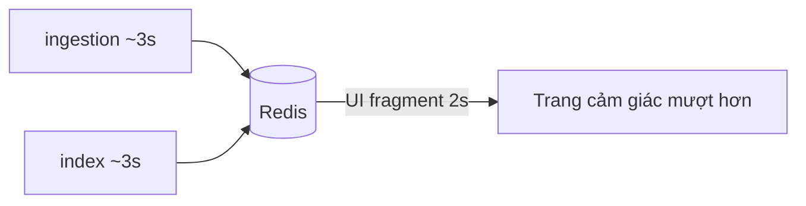

| Ưu | Nhược |
|----|--------|
| An toàn, ít rủi ro API | Giá trong Redis có thể cũ tới ~3s; UI 2s chỉ “nhìn lại” cùng snapshot |

---

### 5b — UI 2s + ingestion poll ~2s

**Đổi:** UI 2s **và** `ingestion.poll_interval_seconds: 2` (cân nhắc index `poll_seconds_trading: 2`).  
**Giữ:** KBS batch 1 shot; SSI chỉ index.

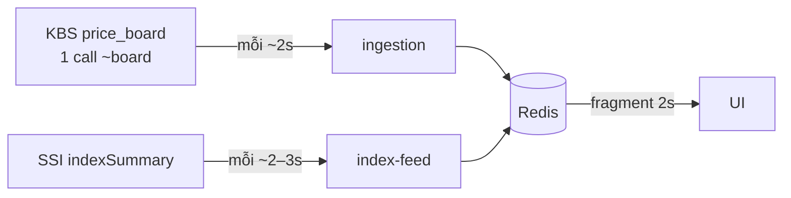

| Ưu | Nhược |
|----|--------|
| Data trên Redis mới hơn → UI 2s có ý nghĩa | Tốn rpm KBS hơn; **nên đo lại trong giờ GD** trước khi chốt |

---

### 5c — Dừng / chờ (Master ack, giờ giao dịch)

**Không đổi config.** Chỉ giữ hiện trạng + tài liệu này.

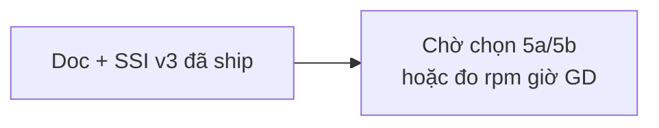

---

## 3. So sánh nguồn (nhắc bench 2026-10-20)

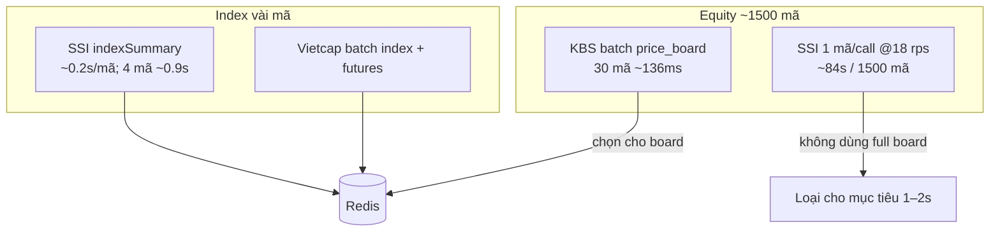

---

## 4. Parallel và pipeline tính CP / filter (an toàn)

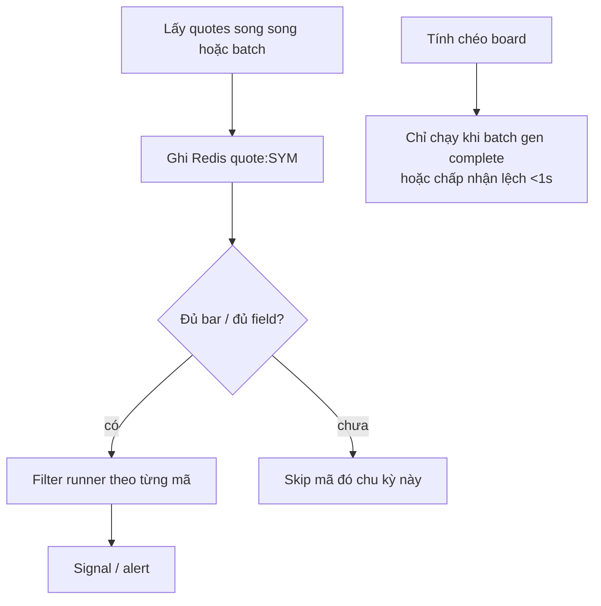

---

## 5. Quyết định kiến trúc: WebSocket-first (chốt 2026-10-20)

### 5.1 Nguyên tắc

1. **Nguồn nóng chính:** SSI Market WebSocket (`wss://stream.ssi.com.vn`, channel `DATA`) — **không OTP**.  
2. **Backup:** REST hiện có (`indexSummary` / `ohlc` / KBS `price_board`) khi WS down, im lặng quá ngưỡng, hoặc cần lịch sử.  
3. **Giữ MVC:** chỉ **service nền** nói chuyện SSI; UI **chỉ đọc Redis** (không WS từ browser).  
4. **Cùng hợp đồng Redis** với hôm nay (`idx:quote:*`, `quote:*`, `spark:*`) → UI / filter không đổi schema.  
5. **Tách process:** service stream riêng (khuyến nghị) — không nhét WS vào vòng poll REST của `index-feed` (tránh block event loop / khó restart).

### 5.2 Kiến trúc tối ưu (mục tiêu)

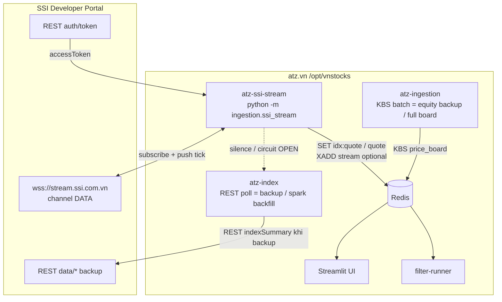

**Vì sao tách `atz-ssi-stream`?**

| Tiêu chí | Gắn vào `index-feed` | Service riêng `ssi-stream` |
|----------|----------------------|----------------------------|
| Restart khi WS lỗi | Kéo theo cả REST/spark | Chỉ stream |
| CPU/blocking | Dễ tranh chấp với poll | Một trách nhiệm |
| Scale sau (nhiều topic) | Phình container index | Scale độc lập |
| Ops | Ít container hơn | +1 service (đáng với WS-first) |

### 5.3 Luồng runtime (primary + backup)

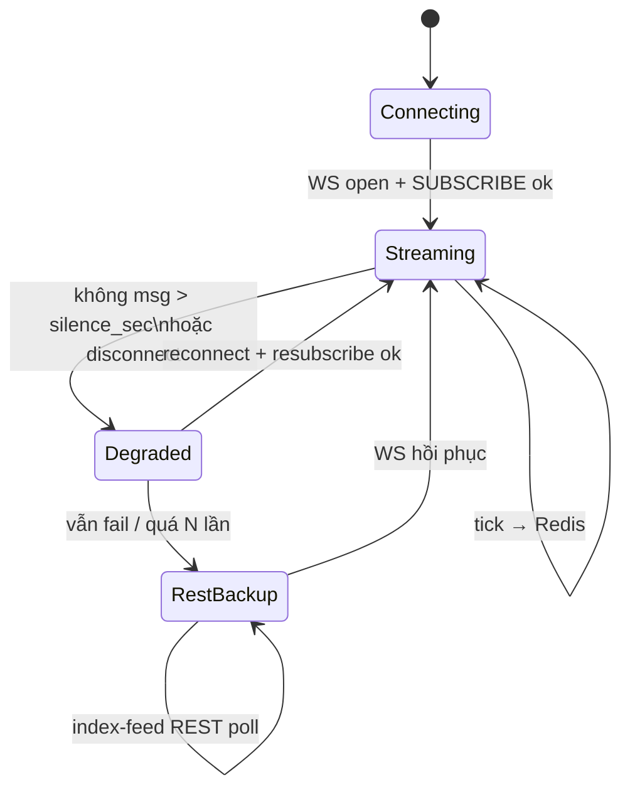

| Mode | Ai ghi Redis index | Ai ghi equity |
|------|--------------------|---------------|
| `streaming` (chuẩn) | `ssi-stream` từ WS (`indexsummary` / `trade.index`) | Phase sau: WS theo nhóm mã; **tạm** KBS batch |
| `degraded` / `rest_backup` | `index-feed` REST SSI (đã có) + Vietcap futures | KBS → VCI như hiện tại |

### 5.4 Subscribe tối ưu (không subscribe cả vũ trụ ngày 1)

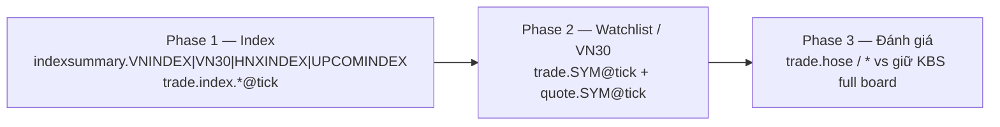

- **Phase 1:** vài topic chỉ số → đủ thẻ Overview mượt.  
- **Phase 2:** mã user pin / VN30 — không `hose` ngay.  
- **Phase 3:** đo tải VPS + quyền SSI rồi mới quyết full board WS hay hybrid KBS.

REST **luôn** giữ cho: OHLC lịch sử / spark backfill / health probe.

### 5.5 Hợp đồng ghi Redis (ổn định UI)

Giữ format hiện có (ví dụ index):

- `idx:quote:{SYM}` — value, ref, change, pct, ts, source=`SSI_WS` (hoặc `SSI` khi REST backup)  
- `spark:{SYM}` — WS tick có thể **append phút**; backfill ngày vẫn REST `ohlc`  
- `idx:health` / `ssi_stream:health` — heartbeat để UI/ops biết mode

### 5.6 UX mượt (song song, không thay WS)

WS chữa **độ mới của data**. Giật trang Streamlit vẫn cần:

- Fragment đọc Redis (có thể 1–2s hoặc theo “có đổi gen”).  
- Tránh rebuild HTML cả bảng khi chỉ 1 ô đổi (epic UI riêng, sau Phase 1).

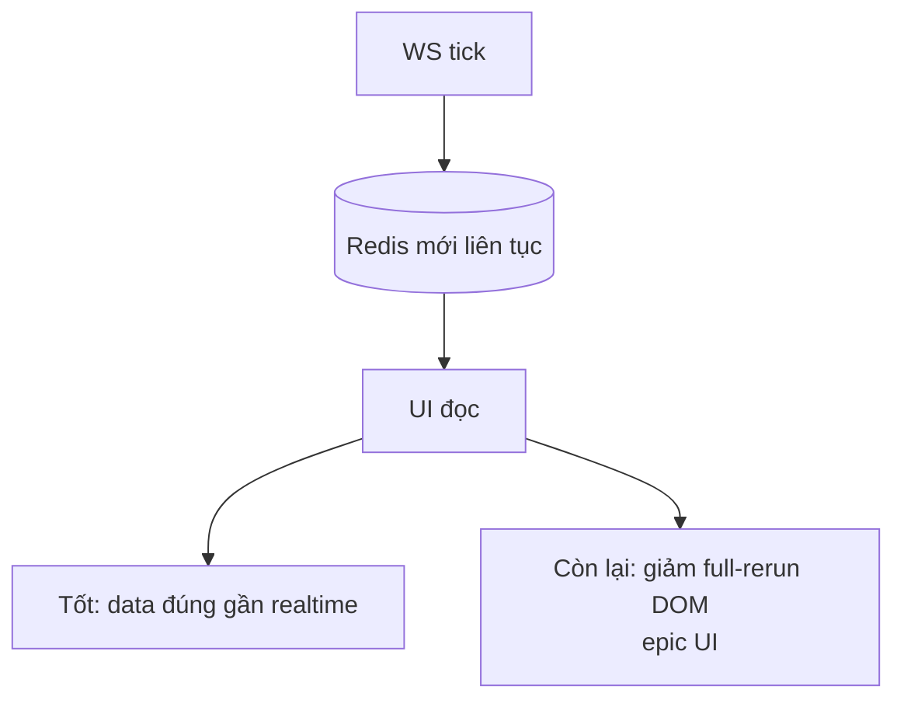

### 5.7 Rủi ro & giảm rủi ro

| Rủi ro | Giảm bằng |
|--------|-----------|
| Mất kết nối / quên PONG | Heartbeat handler + reconnect + resubscribe |
| Im lặng giờ nghỉ | `silence_sec` dài hơn off-hours; không spam REST |
| Message schema đổi | Adapter parse mỏng + log ERR + fallback REST |
| Subscribe quá rộng | Phase 1–2 giới hạn topic trong YAML |
| Trùng ghi WS + REST | Mutex mode: chỉ **một** writer index primary tại một thời điểm |

### 5.8 Config đề xuất (chưa tạo file đến khi authorize code)

`config/ssi_stream.yaml` (ý tưởng):

```yaml
ssi_stream:
  enabled: true
  url: wss://stream.ssi.com.vn
  mode: websocket_primary          # websocket_primary | rest_only
  silence_seconds_trading: 15      # không msg → degraded
  silence_seconds_off: 120
  reconnect_max_backoff_seconds: 60
  topics_phase1:
    - indexsummary.VNINDEX
    - indexsummary.VN30
    - indexsummary.HNXINDEX
    - indexsummary.UPCOMINDEX
    - trade.index.VNINDEX@tick
    - trade.index.VN30@tick
  rest_backup_service: index-feed  # bật poll khi degraded
```

Env giữ: `SSI_CONSUMER_ID` / `SSI_CONSUMER_SECRET` (auth REST lấy token cho WS).

### 5.9 Roadmap triển khai (thay roadmap cũ)

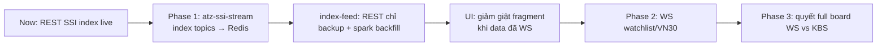

**KBS equity batch:** giữ như **backup / full board** đến hết Phase 2–3 — không bỏ sớm.

---

## 6. Việc human chọn tiếp (triển khai)

- **8a** — Bắt đầu **Phase 1**: scaffold `ingestion.ssi_stream` + compose service + config; probe WS trên VPS; REST backup wiring cho index  
- **8b** — Chỉ **probe WS** 5 phút trên VPS (Pass/Fail topic), chưa scaffold service  
- **8c** — Viết thêm ADR ngắn `docs/adr/0008-ssi-websocket-primary.md` rồi mới code Phase 1  
- **8d** — Chỉnh plan trong md này trước (góp ý topic/phase)

---

## 7. Tham chiếu nhanh

| File | Vai trò |
|------|---------|
| `docs/architecture.md` | MVC/layered gốc — UI đọc Redis |
| `config/ui_realtime.yaml` | `refresh_seconds_trading` (hiện 5) |
| `config/ingestion.yaml` | KBS/VCI equity (backup / full board) |
| `config/index.yaml` | Index REST (sẽ thành backup khi WS primary) |
| `scripts/tools/ssi_v3_bench.py` | Bench SSI REST |
| `PROGRESS.md` §5.14 | Open Q SSI + strategy |
| SSI docs | `wss://stream.ssi.com.vn`, channel `DATA`, không OTP market |
