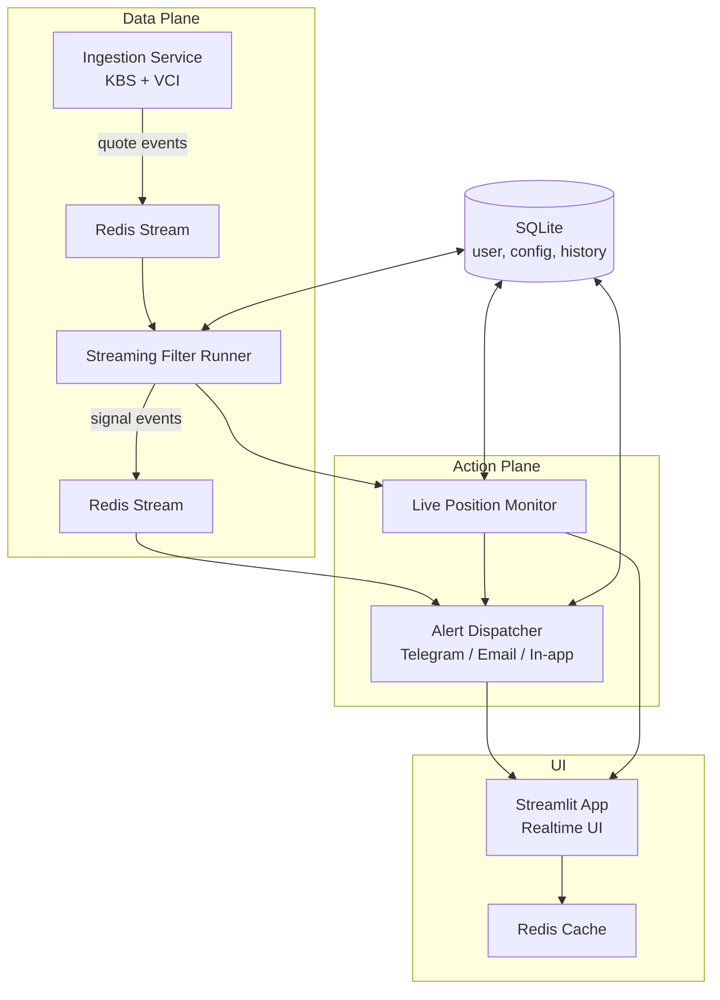

# Kiến trúc Hệ thống Realtime Tracking - atz.vn

**Ngày tạo**: 2026-10-16  
**Phiên bản**: 1.0  
**Mục tiêu**: Chuyển nền tảng từ lọc theo yêu cầu sang near-realtime tracking, hỗ trợ tín hiệu để nhà đầu tư đặt lệnh nhanh trên sàn của họ. Không trading trực tiếp.  
**Quy mô**: 30–100 người (tối đa vài trăm).  
**Nguyên tắc**: Modular (Karpathy-style), explicit config, dễ bảo trì/debug/mở rộng, production-grade resilience.

---

## 1. Kiến trúc tổng thể



**Thứ tự triển khai đề xuất**:
1. Ingestion Service + Redis
2. Streaming Filter Runner
3. Alert Dispatcher
4. Live Position Monitor
5. Cập nhật UI Streamlit
6. Order Action Helper

---

## 2. Data Ingestion Layer (Production-grade)

### Mục tiêu
Nhận dữ liệu near-realtime từ KBS (ưu tiên) và VCI (dự phòng), chuẩn hóa, cache Redis, publish event. An toàn rate limit Golden (≤ 380 req/phút).

### Kiến trúc
- Orchestrator
- Rate Limiter (Token Bucket ≤ 380 rpm)
- KBS Adapter + Circuit Breaker
- VCI Adapter + Circuit Breaker
- Normalizer
- Change Detector
- Redis Cache (`quote:{symbol}`)
- Event Publisher (Redis Stream)
- Health & Metrics

### Resilience
- Circuit Breaker mỗi nguồn (5 lỗi / 60s → Open 45s)
- Timeout 8s / request, retry 2 lần + jitter
- Graceful Degradation: cả hai nguồn lỗi → chỉ cache, tăng interval
- Structured log với debug label `[DBG-INGEST-...]`

### Hợp đồng Normalized Quote
```json
{
  "symbol": "VNM",
  "exchange": "HOSE",
  "timestamp": "2026-10-16T10:07:00+07:00",
  "price": 62500.0,
  "change": 500.0,
  "change_pct": 0.81,
  "volume": 1250000,
  "open": 62000.0,
  "high": 63000.0,
  "low": 61800.0,
  "ref_price": 62000.0,
  "ceiling_price": 66300.0,
  "floor_price": 57700.0,
  "source": "kbs",
  "batch_id": "b_20261016_100700",
  "latency_ms": 420
}
```

### Cấu hình mẫu
```yaml
ingestion:
  primary_source: KBS
  fallback_source: VCI
  poll_interval_seconds: 8
  batch_size: 50
  safety_max_rpm: 380
  request_timeout_seconds: 8
  circuit_breaker:
    failure_threshold: 5
    recovery_timeout_seconds: 45
```

---

## 3. Streaming Filter Runner

### Mục tiêu
Tiêu thụ quote events, chạy filter plugin + composite hiện có cho từng user, phát signal khi match.

### Thành phần
- Event Consumer (Redis Stream)
- Filter Registry (load từ `filters/`)
- User Filter Resolver
- Evaluator (timeout 2s / filter, isolate lỗi)
- Signal Deduplicator
- Signal Publisher
- Health Monitor

### Resilience
- Timeout + error isolation per filter
- Filter circuit: lỗi liên tục → tạm disable
- Dedup window (mặc định 600s)
- Backpressure trên stream

### Hợp đồng Signal
```json
{
  "signal_id": "sig_...",
  "user_id": "...",
  "symbol": "VNM",
  "timestamp": "...",
  "filter_name": "canslim_breakout",
  "direction": "BUY",
  "price": 62500.0,
  "reason": "...",
  "confidence": 0.82
}
```

---

## 4. Realtime Alert Dispatcher

### Mục tiêu
Nhận signal, gửi đa kênh theo preference user (Telegram ưu tiên, Email Brevo, In-app).

### Thành phần
- Signal Consumer
- Preference Resolver
- Channel Router + Fallback
- Telegram / Email / In-app Adapters
- Delivery Tracker
- Rate Limiter (per user)

### Resilience
- Circuit Breaker per channel
- Retry + timeout
- Rate limit gửi (10/5min, 30/hour)
- Quiet hours hỗ trợ
- Delivery log trong SQLite

---

## 5. Live Position Monitor

### Mục tiêu
Theo dõi vị thế user đã nhập, tính P&L near-realtime, cảnh báo SL/TP/volatility.

### Thành phần
- Position Store (SQLite)
- Price Subscriber
- P&L Calculator
- Threshold Evaluator
- Alert Bridge → Alert Dispatcher

### Resilience
- Stale data marking
- Dedup cảnh báo
- Timeout đọc giá

---

## 6. UI Realtime & Order Action Helper

### UI
- Đọc Redis cache + signal gần đây
- Signal Feed + Live Position Table
- Polling nhẹ hoặc fragment
- Badge trạng thái dữ liệu

### Order Action Helper
- Format tín hiệu chuẩn
- Nút Copy mã + thông số
- (Tuỳ chọn) Deep-link app sàn
- Lịch sử tín hiệu

---

## 7. Cơ chế xuyên suốt

- Debug Label trên mọi log
- Circuit Breaker, Rate Limiter, Graceful Degradation
- Deduplication
- Explicit Config
- Health checks
- Modular, không hardcode

---

## 8. Hạ tầng

- Docker Compose trên VPS hiện tại
- Redis (cache + stream)
- SQLite (giữ multi-user)
- Streamlit + Authentik giữ nguyên
- Portainer quản lý

---

*Tài liệu này tổng hợp toàn bộ thiết kế từ phiên làm việc 2026-10-16. Dùng làm nguồn chân lý cho triển khai.*
