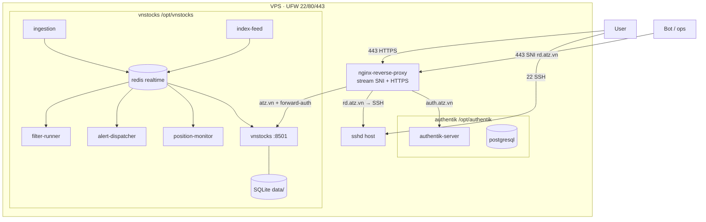

# Kiến trúc mạng VPS — atz.vn

> Lọc từ báo cáo snapshot VPS (2026-10-17). Chỉ tài liệu trong repo — **không** tự sửa nginx stream / sshd / firewall trừ brief + `user_confirmed_infra: yes`.  
> Nguồn gốc (ngoài repo, chỉ tham chiếu): Obsidian `skykb/raw/inbox/VPS_NETWORK_ARCHITECTURE.md`.

## 1. Tổng quan

| Hạng mục | Giá trị |
|----------|---------|
| VPS | `112.213.88.230` (PA Việt Nam), Ubuntu + Docker |
| UFW | Chỉ `22/tcp`, `80/tcp`, `443/tcp` (IPv4+IPv6) |
| Cổng công khai | **Chỉ nginx** (80, 443). Streamlit / Portainer **không** public |

| Bind host | Tiến trình | Ghi chú |
|-----------|------------|---------|
| `0.0.0.0:22` | sshd | SSH trực tiếp |
| `0.0.0.0:80` | docker-proxy → nginx | HTTP, ACME, redirect |
| `0.0.0.0:443` | docker-proxy → nginx | **stream SNI**: HTTPS + SSH-over-443 |
| `127.0.0.1:8501` | → vnstocks | Streamlit, localhost only |
| `127.0.0.1:9443` | → portainer | Localhost; dùng SSH tunnel |

## 2. Sơ đồ

## 3. Luồng nginx (443)

1. **Stream (`ssl_preread`)** theo SNI:
   - `rd.atz.vn` → TLS terminate nội bộ → **sshd host** (`172.17.0.1:22`) — đường **SSH-over-443** (ProxyCommand / openssl). **Cấm sửa** trừ confirm.
   - SNI khác → HTTP block HTTPS (PROXY protocol).
2. **HTTP vhost:**
   - `auth.atz.vn` → `authentik-server:9000`
   - `atz.vn` / `www` → `auth_request` outpost → `vnstocks:8501` (resolver Docker `127.0.0.11`)
   - Host lạ → deny
3. **:80** — ACME webroot + redirect

Config nginx: volume Docker `n8n_nginx_config` (di sản tên `n8n_*` từ image PA — **không xóa** network/volume đang dùng). Cert: `n8n_letsencrypt`.  
Compose nginx host path: `/opt/nginx` (không nằm trong repo app).

## 4. Mạng Docker

| Mạng | Vai trò | Thành viên chính |
|------|---------|------------------|
| `n8n_proxy-network` | nginx ↔ Authentik | nginx, authentik-server |
| `vnstocks_default` | nginx ↔ app + Internet outbound | nginx, vnstocks, ingestion, index, filter, alert |
| `vnstocks_realtime` | **internal** — chỉ Redis hot path | vnstocks, redis, ingestion, index, filter, alert, position |
| `authentik_internal` | Authentik ↔ Postgres | server, worker, postgresql |

**An toàn:** Redis và Postgres Authentik **không** gắn nginx → không lộ ra ngoài qua proxy.  
**Cấm bot:** `docker network rm` các mạng trên; gắn `vnstocks` vào `authentik_internal`; `down -v` xóa volume.

## 5. Compose projects & container

| Project (path) | Container | Vai trò |
|----------------|-----------|---------|
| `nginx` (`/opt/nginx`) | nginx-reverse-proxy | TLS, SNI, SSH-over-443, auth_request |
| `authentik` (`/opt/authentik`) | authentik-server/worker/postgresql | SSO |
| `vnstocks` (`/opt/vnstocks`) | vnstocks, atz-ingestion, atz-index, atz-filter-runner, atz-alert, atz-position, atz-redis | App + realtime |
| (độc lập) | portainer | UI Docker, localhost:9443 |
| Di sản | n8n, certbot (Exited) | Chờ dọn; **giữ** volume nginx + `n8n_proxy-network` |

Deploy app:  
`cd /opt/vnstocks && DOCKER_BUILDKIT=1 docker compose build <svc> && docker compose up -d --no-deps <svc>`  
rồi `/usr/local/bin/atz-check-upstream` (kiểm tra tên container `vnstocks` + resolve nginx).

## 6. Dữ liệu

| Store | Nội dung |
|-------|----------|
| Redis `atz-redis` | `quote:*`, `idx:*`, `spark:*`, `pos:live:*`, streams |
| SQLite `/opt/vnstocks/data/signals.db` | Tín hiệu, snapshot bền |
| Volumes app | `./data`, `./logs`, `./vnstock_home`, `./redis_data` |

## 7. Domain

| Domain | Đích |
|--------|------|
| `atz.vn`, `www.atz.vn` | Forward-auth → Streamlit |
| `auth.atz.vn` | Authentik |
| `rd.atz.vn` | SSH-over-443 → host sshd |

## 8. Vận hành (tóm tắt)

- Cron certbot host + copy cert vào volume nginx  
- Backup: cron `vps-backup`; tool `atz-backup` (mã hoá, giữ bản gần)  
- SSH: xem §11  
- Portainer: `ssh -L 9443:127.0.0.1:9443 …`

## 9. Việc tồn (hạ tầng — không tự làm trong brief app)

1. Dọn n8n/certbot exited; giữ volume nginx + `n8n_proxy-network`  
2. Rebuild image đồng bộ cho ingestion/index/alert/position nếu còn lệch digest  
3. Rate-limit / fail2ban login Authentik  
4. Cảnh báo service down / cert sắp hết hạn  
5. Pin/cập nhật digest image nginx có kiểm soát  

## 10. Quy tắc cho bot (VPSBot / SecConfBot)

| Được | Không |
|------|------|
| `build` + `up -d --no-deps` service app trong `/opt/vnstocks` | Tự sửa `stream.d` / UFW / sshd **trừ** brief + `user_confirmed_infra: yes` |
| Đọc `atz-check-upstream`, log container | Xóa volume Redis/SQLite/Authentik PG |
| Brief infra: cập nhật allowlist IP nhà / kiểm tra SSH:443 khi Mac không vào được | Join nhầm network `authentik_internal` |
| Brief + confirm mới đụng nginx/Authentik routing | |

Code app thường do **Cursor**; VPSBot (khi bật lại) ưu tiên **ops/SSH:443** và việc infra có confirm.

## 11. SSH dual-path (đã chốt 2026-10-17)

| Đường | Ai dùng | Mục đích |
|-------|---------|----------|
| **`:22` trực tiếp** | Mac (nhà / mạng tin cậy), key-only | Deploy / debug hàng ngày — thuận tiện |
| **`:443` SNI `rd.atz.vn`** | Dự phòng; **VPSBot** khi cần | Mạng chặn 22; hoặc nhờ bot **cập nhật allowlist IP nhà** / sửa ops khi Mac không SSH được |

**Giữ cả hai.** Không tắt stream SSH-over-443 chỉ vì đã có 22.  
**Không** đổi UFW/stream/sshd từ Cursor trừ khi chủ repo confirm rõ.

Xem thêm: `docs/architecture.md`, `docs/specs/ACCOUNT_UX_AUTHENTIK_BFF.md`, `docs/bots/vpsbot/PROTOCOL.md`.
