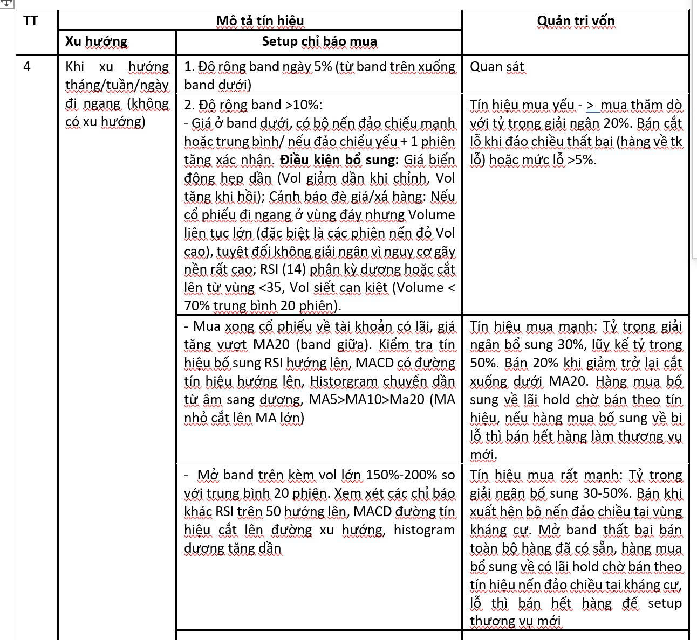
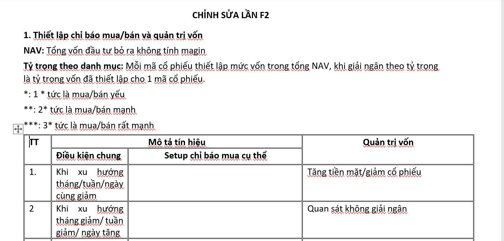
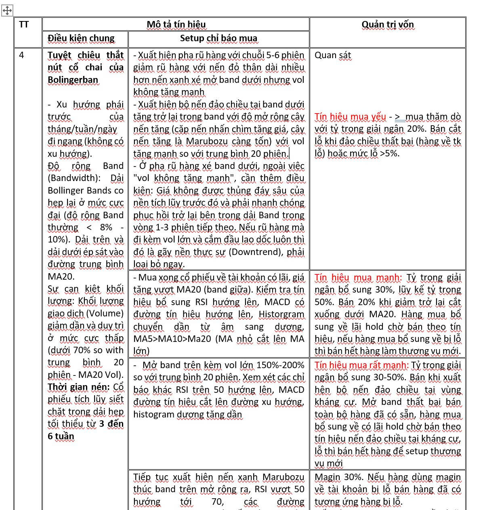

**CHỈNH SỬA LẦN F2**

**1. Thiết lập chỉ báo mua/bán và quản trị vốn**

**NAV:** Tổng vốn đầu tư bỏ ra không tính magin

**Tỷ trọng theo danh mục:** Mỗi mã cổ phiếu thiết lập mức vốn trong tổng NAV, khi giải ngân theo tỷ trọng là tỷ trọng vốn đã thiết lập cho 1 mã cổ phiếu.

\*: 1 \* tức là mua/bán yếu

\*\*: 2\* tức là mua/bán mạnh

\*\*\*: 3\* tức là mua/bán rất mạnh.

**2. Chỉ tiêu lọc**

- Khối lượng giao dịch trung bình 20 phiên 500k đến 1 triệu cổ lọc 10 cổ phiếu tốt nhất;

- khối lượng trung bình 20 phiên 1 triệu đến 2 triệu cổ lọc 20 cổ phiếu;

- khối lượng trung bình 20 phiên > 2 triệu cổ lọc 20 cổ phiếu tốt nhất.

| --- | --- | --- | --- |
| **TT** | **Mô tả tín hiệu** | | **Quản trị vốn** |
| **Điều kiện chung** | **Setup chỉ báo mua cụ thể** |
| 1. | Khi xu hướng tháng/tuần/ngày cùng giảm |  | Tăng tiền mặt/giảm cổ phiếu |
| 2 | Khi xu hướng tháng giảm/ tuần giảm/ ngày tăng |  | Quan sát không giải ngân |
| 3 | **Bolingerban đi ngang**  - Khi xu hướng tháng/tuần/ngày đi ngang (không có xu hướng). | 1. Độ rộng band ngày 5% (từ band trên xuống band dưới) | Quan sát |
|  | 2. Độ rộng band >10%:  - Giá ở band dưới, có bộ nến đảo chiểu mạnh hoặc trung bình/ nếu đảo chiểu yếu + 1 phiên tăng xác nhận.  - Giá đi ngang vùng band dưới tạo 2 đáy RSI, khí RSI tăng vượt đáy trung tâm mua trên khung 1h hoặc 4h.  \* **Điều kiện bổ sung:** Giá biến động hẹp dần (Vol giảm dần khi chỉnh, Vol tăng khi hồi); Cảnh báo đè giá/xả hàng: Nếu cổ phiếu đi ngang ở vùng đáy nhưng Volume liên tục lớn (đặc biệt là các phiên nến đỏ Vol cao), tuyệt đối không giải ngân vì nguy cơ gãy nền rất cao; RSI (14) phân kỳ dương hoặc cắt lên từ vùng <35, Vol siết cạn kiệt (Volume < 70% trung bình 20 phiên). | Tín hiệu mua yếu - > mua thăm dò với tỷ trọng giải ngân 20%. Bán cắt lỗ khi đảo chiều thất bại (hàng về tk lỗ) hoặc mức lỗ >5%. |
|  |  | - Mua xong cổ phiếu về tài khoản có lãi, giá tăng vượt MA20 (band giữa). Kiểm tra tín hiệu bổ sung RSI hướng lên, MACD có đường tín hiệu hướng lên, Historgram chuyển dần từ âm sang dương, MA5>MA10>Ma20 (MA nhỏ cắt lên MA lớn) | Tín hiệu mua mạnh: Tỷ trọng giải ngân bổ sung 30%, lũy kế tỷ trọng 50%. Bán 20% khi giảm trở lại cắt xuống dưới MA20. Hàng mua bổ sung về lãi hold chờ bán theo tín hiệu, nếu hàng mua bổ sung về bị lỗ thì bán hết hàng làm thương vụ mới. |
|  |  | - Mở band trên kèm vol lớn 150%-200% so với trung bình 20 phiên. Xem xét các chỉ báo khác RSI trên 50 hướng lên, MACD đường tín hiệu cắt lên đường xu hướng, histogram dương tăng dần | Tín hiệu mua rất mạnh: Tỷ trọng giải ngân bổ sung 30-50%. Bán khi xuất hện bộ nến đảo chiều tại vùng kháng cự. Mở band thất bại bán toàn bộ hàng đã có sẵn, hàng mua bổ sung về có lãi hold chờ bán theo tín hiệu nến đảo chiều tại kháng cự, lỗ thì bán hết hàng để setup thương vụ mới |

| --- | --- | --- | --- |
| **TT** | **Mô tả tín hiệu** | | **Quản trị vốn** |
| **Điều kiện chung** | **Setup chỉ báo mua** |
| 4 | **Tuyệt chiêu thắt nút cổ chai của Bolingerban**  - Xu hướng phái trước của tháng/tuần/ngày đi ngang (không có xu hướng).  Độ rộng Band (Bandwidth): Dải Bollinger Bands co hẹp lại ở mức cực đại (độ rộng Band thường < 8% - 10%). Dải trên và dải dưới ép sát vào đường trung bình MA20.  Sự cạn kiệt khối lượng: Khối lượng giao dịch (Volume) giảm dần và duy trì ở mức cực thấp (dưới 70% so with trung bình 20 phiên - MA20 Vol).  **Thời gian nén:** Cổ phiếu tích lũy siết chặt trong dải hẹp tối thiểu từ **3 đến 6 tuần** | - Xuất hiện pha rũ hàng với chuỗi 5-6 phiên giảm rũ hàng với nến đỏ thân dài nhiều hơn nến xanh xé mở band dưới nhưng vol không tăng mạnh  - Xuất hiện bộ nến đảo chiều tại band dưới tăng trở lại trong band với độ mở rộng cây nến tăng (cặp nến nhấn chìm tăng giá, cây nến tăng là Marubozu càng tốn) với vol tăng mạnh so với trung bình 20 phiên.  - Ở pha rũ hàng xé band dưới, ngoài việc "vol không tăng mạnh", cần thêm điều kiện: Giá không được thủng đáy sâu của nền tích lũy trước đó và phải nhanh chóng phục hồi trở lại bên trong dải Band trong vòng 1-3 phiên tiếp theo. Nếu rũ hàng mà đi kèm vol lớn và cắm đầu lao dốc luôn thì đó là gãy nền thực sự (Downtrend), phải loại bỏ ngay. | Quan sát  Tín hiệu mua yếu - > mua thăm dò với tỷ trọng giải ngân 20%. Bán cắt lỗ khi đảo chiều thất bại (hàng về tk lỗ) hoặc mức lỗ >5%. |
| - Mua xong cổ phiếu về tài khoản có lãi, giá tăng vượt MA20 (band giữa). Kiểm tra tín hiệu bổ sung RSI hướng lên, MACD có đường tín hiệu hướng lên, Historgram chuyển dần từ âm sang dương, MA5>MA10>Ma20 (MA nhỏ cắt lên MA lớn) | Tín hiệu mua mạnh: Tỷ trọng giải ngân bổ sung 30%, lũy kế tỷ trọng 50%. Bán 20% khi giảm trở lại cắt xuống dưới MA20. Hàng mua bổ sung về lãi hold chờ bán theo tín hiệu, nếu hàng mua bổ sung về bị lỗ thì bán hết hàng làm thương vụ mới. |
| - Mở band trên kèm vol lớn 150%-200% so với trung bình 20 phiên. Xem xét các chỉ báo khác RSI trên 50 hướng lên, MACD đường tín hiệu cắt lên đường xu hướng, histogram dương tăng dần | Tín hiệu mua rất mạnh: Tỷ trọng giải ngân bổ sung 30-50%. Bán khi xuất hện bộ nến đảo chiều tại vùng kháng cự. Mở band thất bại bán toàn bộ hàng đã có sẵn, hàng mua bổ sung về có lãi hold chờ bán theo tín hiệu nến đảo chiều tại kháng cự, lỗ thì bán hết hàng để setup thương vụ mới |
| Tiếp tục xuất hiện nến xanh Marubozu thúc band trên mở rộng ra, RSI vượt 50 hướng tới 70, các đường MA5>MA10>MA20 và nếu các MA này tiếp tục cắt lên MA50, các đường Ma sắp xếp theo thứ tự hướng lên | Magin 30%. Nếu hàng dùng magin về tài khoản bị lỗ bán hàng đã có tương ứng hàng bị lỗ.  Nếu hàng magin mua xong về có lãi và tín hiệu Ma tiếp tục tăng mạnh MA20 cắt lên MA50 thì magin 20% cuối cùng, hàng mới mua về lỗ bán 30% hàng magin đã có, nếu hàng magin lỗ 5% bán tất thiết lập thương vụ mới. Nếu hàng magin cuối cùng về tài khoản có lãi thì hold đến khi có tín hiệu đảo chiều nến nhật được xác định ở vùng kháng cự hoặc xuất hiện mô hình đảo chiều 2 đỉnh trên chat 1h.  Khuyến nghị: Chỉ nên dùng Margin khi toàn bộ phần vị thế cơ sở trước đó đã có lợi nhuận đệm chắc chắn (từ 7% - 10% trở lên) và cổ phiếu đang nằm trong xu hướng tăng mạnh (Uptrend).  Tuyệt đối không dùng margin cho lần giải ngân mua đuổi khi RSI đã tiến sát 70, vì đây thường là giai đoạn rung lắc mạnh trước khi hình thành các nhịp nước rút cuối cùng. |

## Extracted media

### Sidecar images (`sidecar/`)

- 
- 
- 
