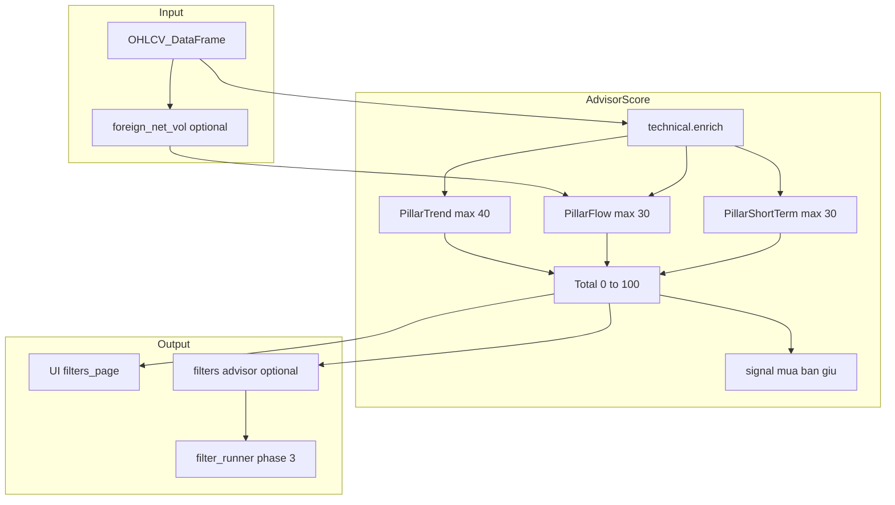

# Hướng 1 — Bộ lọc cố vấn: Scoring 0–100 & Debug overlay

**Nhánh:** `feature/filter-scoring`  
**Ngày:** 2026-10-25  
**Mục tiêu:** Trợ lý giao dịch — sàng lọc, chấm điểm 0–100, gợi ý mua/bán/giữ; UI tùy ngưỡng + lớp giải thích “vì sao mã lọt top”.

---

## 1. Hiện trạng (tái sử dụng)

| Thành phần | Vai trò |
|------------|---------|
| [`src/atz/filters/*.py`](../../src/atz/filters/) | Plugin `FILTER` + `evaluate(bars)` → `SignalResult` (`matched`, `signal_type`, `reason`, `details`) |
| [`src/atz/analysis/technical.py`](../../src/atz/analysis/technical.py) | MA, RSI, BB, MACD, enrich — **không thêm pandas-ta/TA-Lib** |
| [`src/atz/filters/foreign.py`](../../src/atz/filters/foreign.py), [`volume.py`](../../src/atz/filters/volume.py) | Dòng tiền khối ngoại, KL đột biến |
| [`src/atz/engine/composite.py`](../../src/atz/engine/composite.py) | `weighted` — cộng trọng số filter con (không phải thang 0–100 thống nhất) |
| [`src/atz/ui/filters_page.py`](../../src/atz/ui/filters_page.py) | Form tham số động, “Chạy lọc” batch |
| [`src/atz/ui/industry_top.py`](../../src/atz/ui/industry_top.py) | Ranking ngành riêng (70% sức mạnh giá / 30% thanh khoản) — **không gộp** vào advisor |
| [`src/atz/filter_runner/runner.py`](../../src/atz/filter_runner/runner.py) | Realtime; `confidence()` đọc `details.score/total` hoặc `strength` |
| [`src/atz/ui/debug_overlay.py`](../../src/atz/ui/debug_overlay.py) | Chip ⌘⇧D, `dbg_anchor`, `config/debug_overlay.yaml` |
| [`backend/screener.py`](../../backend/screener.py) | `FilterEngine` bảng giá realtime — **domain khác**, không trộn |

---

## 2. Thiết kế tổng thể



### 2.1 Module chấm điểm (mới)

**File đề xuất:** [`src/atz/engine/advisor_score.py`](../../src/atz/engine/advisor_score.py)

- **Đầu vào:** `bars: pd.DataFrame` (cùng hợp đồng với filter hiện tại), `params` (override UI), optional `config` từ YAML.
- **Đầu ra:** dataclass `AdvisorScore`:
  - `total: float` (0–100, làm tròn 1 chữ số)
  - `pillars: dict` — `trend`, `flow`, `short_term` (điểm từng trụ + `breakdown` dict số liệu thô)
  - `recommendation: str` — `mua` | `ban` | `giu` (ngưỡng configurable)
  - `reason: str` — một dòng tóm tắt cho bảng UI

**Config:** [`config/advisor_score.yaml`](../../config/advisor_score.yaml)

```yaml
advisor_score:
  weights:
    trend: 0.40
    flow: 0.30
    short_term: 0.30
  trend:
    ma_fast: 10
    ma_slow: 50
  flow:
    foreign_days: 5
    foreign_min_net_vol: 0
    volume_avg: 20
    volume_spike: 2.0
  short_term:
    rsi_length: 14
    rsi_buy_zone: [30, 45]
    rsi_sell_above: 70
    bb_length: 20
    bb_k: 2.0
  thresholds:
    buy_min_total: 65
    sell_max_total: 35
```

### 2.2 Logic từng trụ (0 → weight×100)

| Trụ | Trọng số | Tiêu chí (điểm con → chuẩn hóa 0–100 trong trụ) |
|-----|----------|--------------------------------------------------|
| **Xu hướng** | 40% | Giá > MA10, MA10 > MA50; bonus nếu MA10 cắt lên MA50 gần đây (2 phiên) |
| **Dòng tiền** | 30% | Khối ngoại mua ròng `foreign_days` phiên; KL phiên cuối / MA20 vol ≥ `volume_spike` (có thể tách 50/50 trong trụ) |
| **KT ngắn hạn** | 30% | RSI trong vùng mua UI; vị trí trong BB (%B); MACD histogram tăng ≥2 phiên (reuse `macd_improving` nếu đủ dữ liệu) |

- Thiếu cột `foreign_net_vol` → trụ flow chỉ dùng volume (hoặc flow = 0 + flag `flow_partial` trong breakdown).
- Không đủ nến → `total = None`, `reason = "không đủ dữ liệu"` (giống `waiting()`).

### 2.3 Filter plugin (tùy chọn, khuyến nghị Phase 1)

**File:** [`src/atz/filters/advisor.py`](../../src/atz/filters/advisor.py)

- `FILTER.group = "cố vấn"`.
- Params mirror YAML (hoặc subset: `buy_min_total`, `foreign_days`, `rsi_low`, `rsi_high`, `volume_spike`).
- `evaluate()` gọi `compute_advisor_score()`; `matched = total >= buy_min_total` (mua) hoặc tương đương bán nếu thêm mode.
- `details` chứa toàn bộ `breakdown` + `total` + `pillars` → phục vụ debug overlay và `confidence()` realtime.

---

## 3. UI Streamlit

**File chính:** [`src/atz/ui/filters_page.py`](../../src/atz/ui/filters_page.py)

### 3.1 Interactive controls

- Thêm **segment** hoặc checkbox: **“Cố vấn (điểm 0–100)”** bên cạnh chế độ hiện tại.
- Khi bật: hiển thị slider/number_input cho RSI min/max, `foreign_days`, `volume_spike`, `buy_min_total` (map vào params advisor).
- Vẫn dùng `multiselect` mã; có thể **ẩn multiselect filter rời** khi chế độ cố vấn (chỉ chạy advisor) hoặc chạy advisor **song song** filter user chọn — **mặc định đề xuất:** chế độ cố vấn = một pipeline scoring, không bắt buộc bật từng filter rsi/ma.

### 3.2 Bảng kết quả

- Cột: Mã, **Điểm**, Xu hướng, Dòng tiền, KT ngắn hạn, **Gợi ý**, Lý do, Giá.
- **Sắp xếp** theo `Điểm` giảm dần.
- Lọc nhanh: chỉ hiện `Điểm >= ngưỡng`.

### 3.3 Debug overlay (“Tại sao lọt top?”)

- Mỗi hàng: `st.expander(f"{symbol} — breakdown")` liệt kê key/value từ `breakdown` (MA10, MA50, RSI, ratio vol, foreign streak…).
- Phase 2: `dbg_anchor("FILTER-ADVISOR", symbol, json_breakdown)` trên bảng (theo pattern [`debug_overlay.py`](../../src/atz/ui/debug_overlay.py)) — bật trên `dev.atz.vn` qua `config/debug_overlay.yaml`.
- Catalog: thêm một dòng trong [`src/atz/ui/filter_criteria.py`](../../src/atz/ui/filter_criteria.py).

---

## 4. Realtime (Phase 3)

- User bật filter `advisor` trong SQLite `user_filter_configs` → resolver + runner gọi như filter khác.
- Publisher: map `total/100` vào `strength` hoặc `details.score=total`, `details.total=100` để `confidence()` nhất quán.
- **Không** đổi default trong [`config/filter_runner.yaml`](../../config/filter_runner.yaml) cho prod; dev test bằng user config.

---

## 5. Kiểm thử

| File | Nội dung |
|------|----------|
| `tests/test_advisor_score.py` | Fixture CSV nhỏ: trend bullish + foreign streak + volume spike → total trong khoảng kỳ vọng; thiếu cột → partial; thiếu nến → None |
| `tests/test_advisor_filter.py` | Plugin `matched` khi vượt ngưỡng; `details` có pillars |
| (tùy chọn) cập nhật `tests/test_filter_criteria.py` | Catalog có advisor |

Chạy: `pytest tests/test_advisor_score.py tests/test_advisor_filter.py -q`

---

## 6. Lộ trình triển khai

| Phase | Phạm vi | Files |
|-------|---------|-------|
| **P1** | Engine + YAML + tests + UI batch (bảng + expander breakdown) | `engine/advisor_score.py`, `config/advisor_score.yaml`, `filters/advisor.py`, `ui/filters_page.py`, tests |
| **P2** | Debug overlay chips + catalog | `ui/debug_overlay` hooks, `filter_criteria.py` |
| **P3** | Realtime runner + tài liệu User Manual mã lỗi (nếu có ERR mới) | `filter_runner` (chỉ verify), docs troubleshooting |

**Nguyên tắc:** Một PR/commit nhỏ sau mỗi phase; giữ prod không đổi default resolver.

---

## 7. Ngoài phạm vi (lần này)

- Đa khung thời gian (W/H) — chỉ daily như filter hiện tại.
- Thay đổi `backend/screener.FilterEngine` hoặc priceboard SPA.
- Smart money / MCDX trong trụ flow (có thể Phase 4 nếu mentor yêu cầu).
- F1 mode rsi/macd/candle — vẫn chạy độc lập; advisor là lớp tổng hợp riêng.

---

## 8. Bước tiếp theo sau khi duyệt plan

1. Implement **P1** trên `feature/filter-scoring`.
2. Smoke trên `dev.atz.vn`: chọn 5–10 mã, so sánh breakdown với chart.
3. PR → review → merge `feature/realtime-fastapi` (hoặc main theo quy ước repo).
