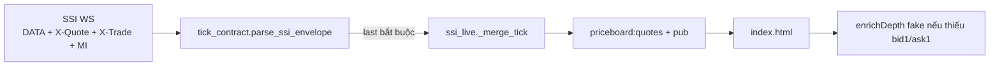

# Plan P1 — Map depth / NN (X-Quote · X-Trade · MI)

**Trạng thái:** Draft sẵn sàng code · **chưa** implement  
**Branch:** `feature/realtime-fastapi`  
**Ngày:** 2026-10-21  
**Phụ thuộc:** P0 tick giờ mở cửa (capture schema thật) · **không** đụng `stream.d` / sshd / UFW / `atz-redis` prod

---

## 1. Mục tiêu

| # | Mục tiêu | Pass khi |
|---|----------|----------|
| P1.1 | Depth 3 cấp từ SSI → FE | `bid1..3` / `bidVol*` / `ask1..3` / `askVol*` cập nhật theo `X-Quote` (không còn fake từ `enrichDepth` khi có data) |
| P1.2 | Match / KL khớp | `matchVol` (+ `last`/`volume` nếu có) từ `X-Trade` / `DATA` |
| P1.3 | Nước ngoài | `foreignBuy` / `foreignSell` từ `MI` (hoặc field NN trong quote) |
| P1.4 | Index GT (Tỷ) | `tradeValue` (hoặc alias) enrichment khi schema SSI rõ |
| P1.5 | Test | `tests/test_tick_contract.py` (+ mở rộng `test_volume_filter` nếu đụng merge) |

Hợp đồng FE (đã có cột): `frontend/index.html` — `data-f=bid*|ask*|fbuy|fsell`.

---

## 2. Hiện trạng (gap)



| Thành phần | Đã có | Gap |
|------------|-------|-----|
| Subscribe | `config/priceboard.yaml` channels đủ 4 kênh | Chưa xác nhận payload thật từng kênh trên VPS |
| Parse | Alias best-effort (`bidPrice1`, `BestBid1`, `offer*`, `fBuyVol`…) | **Drop** nếu `last is None` → X-Quote-only / MI-only có thể mất |
| Merge | Giữ prev khi field `None` | OK — cần parse trả partial depth |
| FE | Cột + render | `enrichDepth` **bịa** depth/NN khi thiếu → che lỗi map |
| Log | Worker LIVE-* | Cần dump **redacted** sample (che token) giờ mở cửa |

---

## 3. Nguyên tắc thiết kế

1. **Partial tick:** cho phép parse **không** có `last` nếu có ít nhất một trong: depth / foreign / matchVol / tradeValue — merge chỉ ghi đè field có giá trị.  
2. **Channel-aware (tuỳ chọn):** nhánh nhẹ theo `channel` (`X-QUOTE` / `X-TRADE` / `MI` / `DATA`) — cùng `build_tick` + merge.  
3. **Không dual-writer:** chỉ ghi `priceboard:*` — **không** `idx:quote:*`.  
4. **Secret:** log chỉ keys + số; **không** log auth / raw token.  
5. **FE:** khi `source=SSI_WS` và đã từng nhận depth thật → **tắt fake** cho symbol đó (hoặc tắt hẳn `enrichDepth` sau P1 Pass).

---

## 4. Bảng map mục tiêu (điền sau capture)

Điền cột «SSI field thực tế» từ sample giờ mở cửa (1–2 mã VN30).

**Trạng thái capture:** off-hours 2026-10-25 — worker `CONNECT`/`SUBSCRIBED` OK; bảng dưới vẫn _TBD_. Runbook: [P0_LIVE_VERIFY.md](../bots/P0_LIVE_VERIFY.md).

**FE gate (prep):** `?fake_depth=0` hoặc `localStorage pb_fake_depth=0` tắt `enrichDepth` fake; symbol đã có `bid1`/`ask1` từ WS không bị fake lại.

| FE / contract | Kênh dự kiến | Alias đã thử trong code | SSI field thực tế | Ghi chú |
|---------------|--------------|-------------------------|-------------------|---------|
| `bid1..3` | X-Quote | `bidPriceN`, `BestBidN`, `g1` | _TBD_ | |
| `bidVol1..3` | X-Quote | `bidVolumeN`, `BestBidVolN` | _TBD_ | |
| `ask1..3` | X-Quote | `offerN`, `offerPriceN`, `BestOfferN` | _TBD_ | |
| `askVol1..3` | X-Quote | `offerVolN`, `BestOfferVolN` | _TBD_ | |
| `last` / `matchVol` | X-Trade / DATA | `matchedPrice`, `matchedVol`, `lot` | _TBD_ | |
| `volume` | DATA / MI | `totalVol`, `nmVolume` | _TBD_ | |
| `foreignBuy` | MI / room | `bq`, `fBuyVol`, `FBuyVol`, `BuyForeignQtty` | bq | KL mua NN |
| `foreignSell` | MI / room | `sq`, `fSellVol`, `FSellVol`, `SellForeignQtty` | sq | KL bán NN |
| `foreignBuyValue` | room | `bv`, `FBuyVal`, `BuyVal` | bv | GT mua |
| `foreignSellValue` | room | `sv`, `FSellVal`, `SellVal` | sv | GT bán |
| `foreignNetVol` / `foreignNetValue` | FE+BE | derived | buy − sell | Cột Ròng |
| `tradeValue` (index) | DATA indexsummary | — | _TBD_ | Index card GT (Tỷ) |

---

## 5. Thứ tự implement (khi phiên mở)

### Bước A — Capture (ops, ~15–30 phút)

```bash
# VPS — log worker (che tay nếu lộ secret)
cd /opt/vnstocks
docker compose -f docker-compose.dev.yml logs -f --tail=200 ssi-worker
```

- Thêm tạm log **DBG-PRICEBOARD-SSI-SAMPLE** (rate-limit 1 msg/channel/phút): `channel` + `sorted(body.keys())` + 1 symbol — **không** full dump auth.  
- Hoặc ghi 5–10 envelope redact vào `docs/refs/` (local) — **không** commit secret.  
- Điền bảng §4.

### Bước B — Code (1 module: `tick_contract`)

File chạm (dự kiến):

| File | Việc |
|------|------|
| `backend/tick_contract.py` | Cho phép partial; bổ sung alias theo bảng §4; optional `tradeValue` |
| `backend/ssi_live.py` | Merge `tradeValue` nếu thêm; giữ volume gate |
| `frontend/index.html` | Gate `enrichDepth` khi có depth thật / flag |
| `tests/test_tick_contract.py` | Fixture envelope X-Quote / X-Trade / MI → assert fields |
| `config/priceboard.yaml` | Chỉ nếu cần topic subscribe thêm (tránh mở rộng sàn ngày 1) |

### Bước C — Verify

| Case | Pass |
|------|------|
| Board equity | bid/ask đổi theo quote, khác fake ổn định theo `symbol` seed |
| NN | fbuy/fsell khác 0 hoặc khớp hướng Fireant cùng mã |
| Index GT | card hiện Tỷ khi có `tradeValue` |
| Volume gate | vẫn `min_volume=500000` |
| Regress | `/healthz` 200 · WS reconnect · không đụng Redis prod |

---

## 6. Ngoài phạm vi P1

- Subscribe cả HOSE/HNX (giữ VN30 + index như config hiện tại).  
- Throttle fan-out >100 client (P2).  
- Gộp `atz-ssi-stream` (P2).  
- Sửa nginx / Authentik / `stream.d`.

---

## 7. Xác nhận trước khi code

Khi đã có sample §4 điền đủ:

```
Chọn:
2a) Implement partial parse + alias theo bảng §4 (tick_contract + test)
2b) Chỉ tắt enrichDepth fake (FE) — chờ capture thêm
2c) Hoãn P1 — ưu tiên P0 browser/WS còn lại
```
