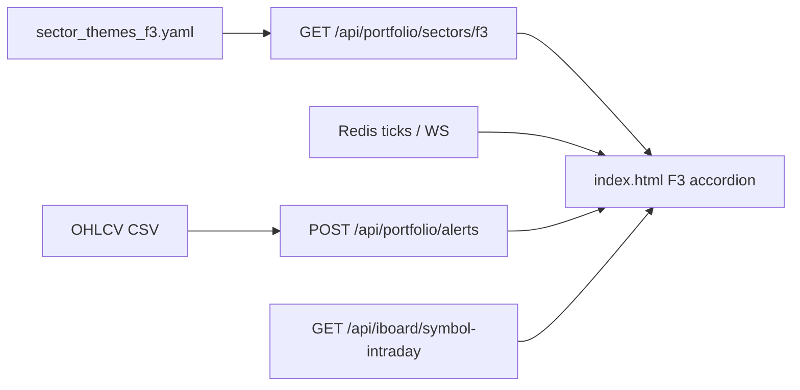

# Spec — iBoard F3 accordion (dev.atz.vn)

Dựa trên [`intent.md`](intent.md). **Chưa code** cho đến khi được duyệt spec này.

## 1. Kiến trúc dữ liệu (FastAPI → Frontend)



### Themes ngành

`GET /api/portfolio/sectors/f3` — **giữ nguyên**

```json
{
  "themes": [
    {
      "id": "f3:ngan_hang",
      "name": "Ngân hàng",
      "symbols": ["VCB", "BID", "CTG"],
      "kind": "f3"
    }
  ]
}
```

Nguồn: [`config/sector_themes_f3.yaml`](config/sector_themes_f3.yaml).

### Cảnh báo kỹ thuật (daily batch)

`POST /api/portfolio/alerts`  
Body: `{ "symbols": ["VCB", "HPG"] }`

```json
{
  "alerts": {
    "VCB": "Giá trên MA50 · BB giữa · gần kháng cự 98.5",
    "HPG": "—"
  }
}
```

- Text từ engine **native** mới (không wrap legacy).  
- Cache `(symbol, session_date)`.  
- **Không** recalc mỗi tick WS.  
- **Không** thêm `/api/trading/sectors` (trading = paper trade).

### Giá realtime & chart (tái dùng)

| Nhu cầu | Nguồn hiện có |
|---------|----------------|
| Last / % | Quotes map + Redis/WS iBoard |
| Spark / intraday | `/api/iboard/equity-spark`, `/api/iboard/symbol-intraday` |

### Cộng đồng (Phase 1)

Không API — UI stub `"—" / "Sắp có"`.

## 2. Engine alert (backend native)

- Module mới: `backend/f3_indicators.py` — MA20/50/100/200, Bollinger Bands, Ichimoku, vùng S/R đơn giản (swing/pivot).  
- Cập nhật [`backend/portfolio_f3.py`](backend/portfolio_f3.py): bỏ import `analysis.f3_alerts` / legacy path; gọi engine native.  
- Config tùy chọn: `config/f3_alerts.yaml` (period / ngưỡng) — không hardcode magic số trong UI.  
- Cache theo `(symbol, session_date)` như hiện tại.

## 3. Cấu trúc UI (Vanilla JS / HTML)

**Mặt đích:** panel F3 trên [`frontend/index.html`](frontend/index.html) — thay chip-picker bằng accordion theo theme.

```
F3Board
├── AccordionItem (mỗi theme)
│   ├── Header: tên ngành · số mã · Δ ngành (nếu có)
│   └── Table 5 cột
│       ├── Symbol (danh sách)
│       ├── Price (last, %change, flash)
│       ├── Chart (mini spark / mở intraday)
│       ├── Alert (text KT từ batch alerts)
│       └── Community (stub)
└── (tuỳ chọn) Toolbar mở tất cả / đóng
```

Hành vi cột:

| Cột | Nguồn |
|-----|--------|
| 1 Danh sách | `themes[].symbols` |
| 2 Giá RT | quote map / WS |
| 3 Đồ thị | equity-spark hoặc nút mở chart intraday sẵn có |
| 4 Cảnh báo KT | `POST /api/portfolio/alerts` (batch khi mở ngành / refresh phiên) |
| 5 Cộng đồng | stub |

Debug id: giữ `pb-ui:portfolio.f3-*`, bổ sung `pb-ui:iboard.f3.board`, `pb-ui:iboard.f3.sector.<id>`.

## 4. File sẽ sửa (Bước 3+ — chưa đụng trong PR này)

| File | Việc |
|------|------|
| `frontend/index.html` | Accordion 5 cột thay chip F3 |
| `backend/portfolio_f3.py` | Bỏ wrap legacy; gọi engine native |
| `backend/f3_indicators.py` (mới) | MA / BB / Ichimoku / S-R |
| `backend/main.py` | Chỉ nếu đổi schema response |
| `config/sector_themes_f3.yaml` | Chỉnh theme nếu cần |
| `config/f3_alerts.yaml` (mới, tùy chọn) | Period / ngưỡng |
| `tests/test_portfolio_f3.py` | Unit API + text alert |

## 5. Cửa dừng

Sau khi có `intent.md` + `spec.md` → **chờ duyệt** trước Bước 3 (`plan.md`) và code production.
