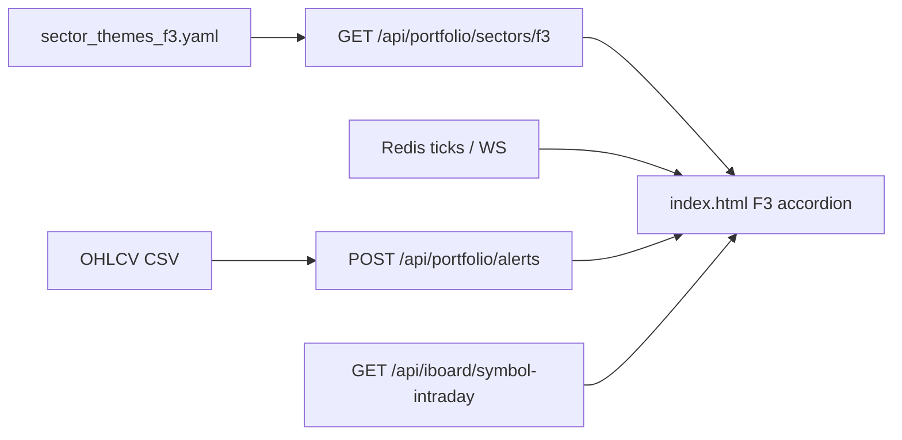

# Spec — iBoard F3 accordion (dev.atz.vn)

Dựa trên [`intent.md`](intent.md). **Chưa code** cho đến khi được duyệt spec này.

## 1. Kiến trúc dữ liệu (FastAPI → Frontend)



### Themes ngành

`GET /api/portfolio/sectors/f3` — **giữ nguyên**

```json
{
  "themes": [
    {
      "id": "f3:ngan_hang",
      "name": "Ngân hàng",
      "symbols": ["VCB", "BID", "CTG"],
      "kind": "f3"
    }
  ]
}
```

Nguồn: [`config/sector_themes_f3.yaml`](config/sector_themes_f3.yaml).

### Cảnh báo kỹ thuật (daily batch)

`POST /api/portfolio/alerts`  
Body: `{ "symbols": ["VCB", "HPG"] }`

```json
{
  "alerts": {
    "VCB": "Giá trên MA50 · BB giữa · gần kháng cự 98.5",
    "HPG": "—"
  }
}
```

- Text từ engine **native** mới (không wrap legacy).  
- Cache `(symbol, session_date)`.  
- **Không** recalc mỗi tick WS.  
- **Không** thêm `/api/trading/sectors` (trading = paper trade).

### Giá realtime & chart (tái dùng)

| Nhu cầu | Nguồn hiện có |
|---------|----------------|
| Last / % | Quotes map + Redis/WS iBoard |
| Spark / intraday | `/api/iboard/equity-spark`, `/api/iboard/symbol-intraday` |

### Cộng đồng (Phase 1)

Không API — UI stub `"—" / "Sắp có"`.

## 2. Engine alert (backend native)

- Module mới: `backend/f3_indicators.py` — MA20/50/100/200, Bollinger Bands, Ichimoku, vùng S/R đơn giản (swing/pivot).  
- Cập nhật [`backend/portfolio_f3.py`](backend/portfolio_f3.py): bỏ import `analysis.f3_alerts` / legacy path; gọi engine native.  
- Config tùy chọn: `config/f3_alerts.yaml` (period / ngưỡng) — không hardcode magic số trong UI.  
- Cache theo `(symbol, session_date)` như hiện tại.

## 3. Cấu trúc UI (Vanilla JS / HTML)

**Mặt đích:** panel F3 trên [`frontend/index.html`](frontend/index.html) — thay chip-picker bằng accordion theo theme.

```
F3Board
├── AccordionItem (mỗi theme)
│   ├── Header: tên ngành · số mã · Δ ngành (nếu có)
│   └── Table 5 cột
│       ├── Symbol (danh sách)
│       ├── Price (last, %change, flash)
│       ├── Chart (mini spark / mở intraday)
│       ├── Alert (text KT từ batch alerts)
│       └── Community (stub)
└── (tuỳ chọn) Toolbar mở tất cả / đóng
```

Hành vi cột:

| Cột | Nguồn |
|-----|--------|
| 1 Danh sách | `themes[].symbols` |
| 2 Giá RT | quote map / WS |
| 3 Đồ thị | equity-spark hoặc nút mở chart intraday sẵn có |
| 4 Cảnh báo KT | `POST /api/portfolio/alerts` (batch khi mở ngành / refresh phiên) |
| 5 Cộng đồng | stub |

Debug id: giữ `pb-ui:portfolio.f3-*`, bổ sung `pb-ui:iboard.f3.board`, `pb-ui:iboard.f3.sector.<id>`.

## 4. File sẽ sửa (Bước 3+ — chưa đụng trong PR này)

| File | Việc |
|------|------|
| `frontend/index.html` | Accordion 5 cột thay chip F3 |
| `backend/portfolio_f3.py` | Bỏ wrap legacy; gọi engine native |
| `backend/f3_indicators.py` (mới) | MA / BB / Ichimoku / S-R |
| `backend/main.py` | Chỉ nếu đổi schema response |
| `config/sector_themes_f3.yaml` | Chỉnh theme nếu cần |
| `config/f3_alerts.yaml` (mới, tùy chọn) | Period / ngưỡng |
| `tests/test_portfolio_f3.py` | Unit API + text alert |

## 5. Cửa dừng

Bản docs này (Bước 1–2) dừng trước code. Bản triển khai đi tiếp ở mục 6 — không có `plan.md` riêng vì packet yêu cầu code luôn theo danh sách file ở mục 4.

## 6. Chỉnh khi triển khai (so với mục 1–4)

Những điểm spec lệch code trên `main` (kể cả commit `feat(portfolio): F3 multi-checkbox preview…`) và cách đã xử lý:

1. **Accordion thay chip + preview hẹp** (commit 26/10). Preview multi-checkbox và nút «Thêm tất cả» không còn. Mỗi dòng mã giữ nút **Thêm** trong cột Mã để vẫn đưa mã vào danh mục — không thêm cột thứ 6.
2. **Vị trí UI:** `#pf-f3-*` nằm tab **Danh mục** của SPA (`frontend/index.html`), không phải lưới giá iBoard. Giữ `pb-ui:portfolio.f3-picker`, thêm `pb-ui:iboard.f3.board` và `pb-ui:iboard.f3.sector.<id>`.
3. **Contract HTTP giữ `ok: true`.** Ví dụ JSON ở mục 1 bỏ field này; client hiện tại đọc `data.ok`. `backend/main.py` không đổi schema.
4. **Câu cảnh báo là trạng thái ngày**, đúng ví dụ «Giá trên MA50 · BB giữa · …», không phải câu sự kiện legacy trong `docs/specs/F3_ALERTS.md` (`xu hướng ngày`, `giảm thủng hỗ trợ`). `tests/test_f3_alerts.py` vẫn khóa engine legacy `analysis.f3_alerts` — module đó không còn được `portfolio_f3` gọi.
5. **Mức S/R trong câu chữ là VND** (cùng `_desk_to_vnd`: OHLCV nhỏ hơn 1000 thì nhân 1000). Ví dụ spec `98.5` là đơn vị nghìn đồng trên CSV; cột Giá SPA hiển thị `98,500`.
6. **% và Δ ngành** lấy từ dòng WS (`state.change_pct`) khi mã có trên bảng giá. `GET /api/portfolio/quotes` chỉ có `price` / `avg_volume_10`, không có % — dùng để lấp giá khi mã chưa có tick.
7. **Đồ thị:** spark tái dùng `renderSparkSvg` + `GET /api/iboard/equity-spark`. Bấm spark gọi `openSymbolDetail` (chart intraday sẵn có, gồm `/api/iboard/symbol-intraday`). Cột 4 không ghép intraday alert — bảng danh mục bên dưới vẫn ghép F3 + intraday như cũ.
8. **`_ensure_legacy_path` giữ trong `portfolio_f3.py`** vì `daily_signals` dùng để nạp filter. Chỉ đường alert F3 bỏ `analysis.f3_alerts`. `Dockerfile.dev` vẫn copy package legacy cho filter / `tests/test_f3_alerts.py`.
9. **File thêm ngoài mục 4** (cần để config vào image dev và catalog debug): `Dockerfile.dev`, `docker-compose.dev.yml`, `frontend/ui_catalog.json`.
10. **Cache:** server `(symbol, session_date)`; trình duyệt cache text đến khi tải lại trang, không gọi lại mỗi tick WS. Mở ngành (hoặc «Mở tất cả») mới batch các mã chưa có trong cache.
